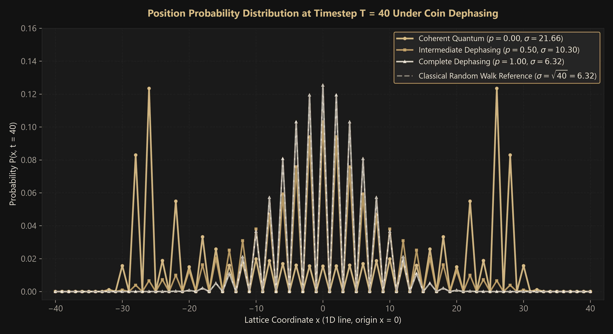
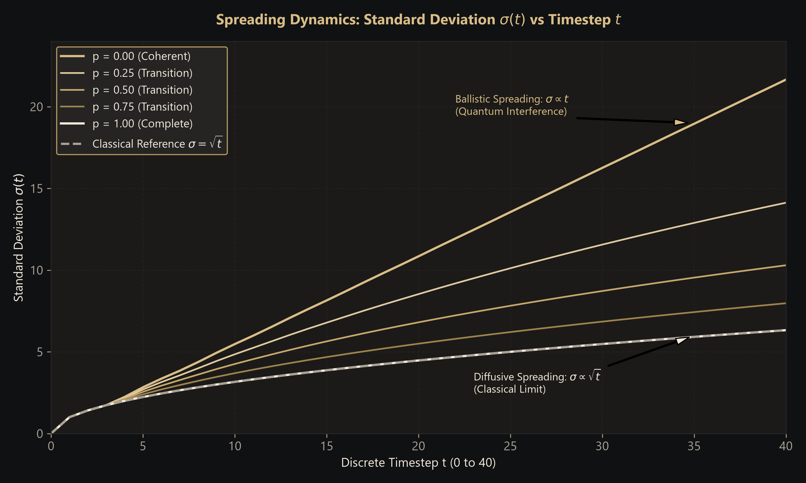
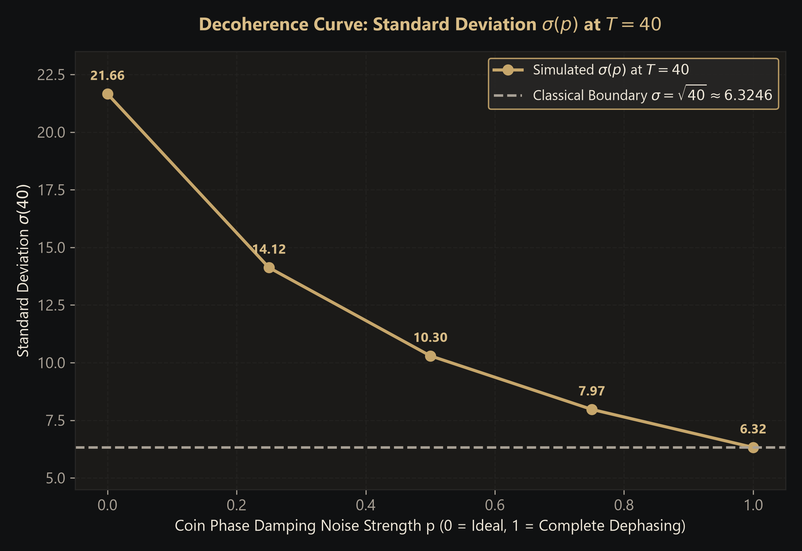
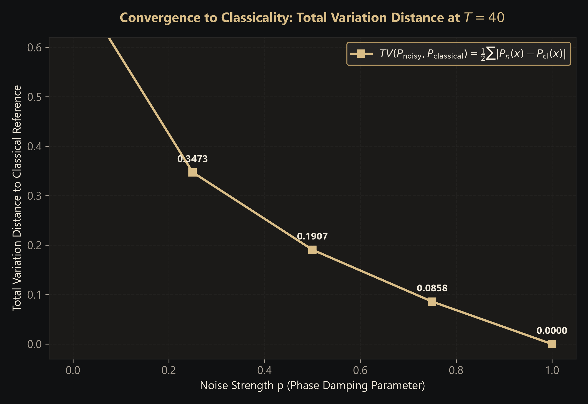
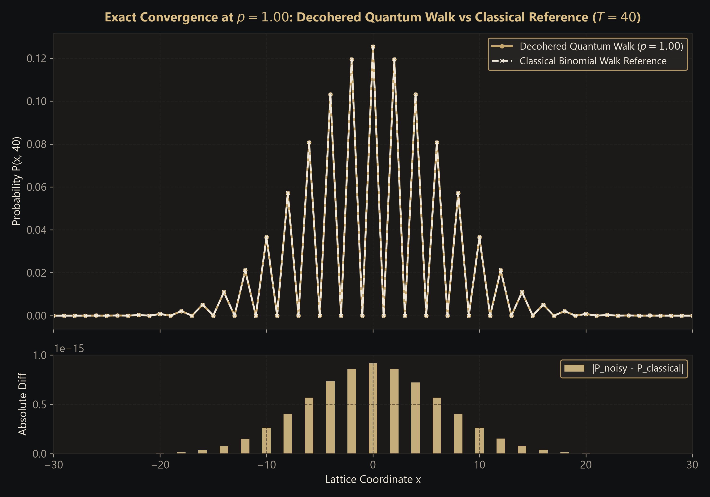

# QUANTUM REALITY: Decoherence Study of a Quantum Walk
## Phase Damping on the Coin Operation of a Discrete-Time Quantum Walk on a 1D Line

**Discipline**: Physics & Computer Science — Internal Assessment (IA) Research Report  
**Author / Project**: QUANTUM REALITY  
**Academic Subtitle**: Decoherence Study of a Quantum Walk  
**Date of Completion**: October 20, 2026  
**Document Designation**: `report/final_ia_report.md`  
**Software Repository**: `D:\VISHAL ANNAN`  
**Core Simulation Engines**: Python 3.11, Qiskit 2.6.0, Qiskit Aer 0.18.0, NumPy 2.4.6, FastAPI 0.150.0  
**Frontend & 3D Stack**: React 19, TypeScript, Three.js, React Three Fiber, Blender 5.2.2 LTS  

---

## Abstract

We present a comprehensive theoretical, numerical, and computational investigation into the quantum-to-classical transition of a discrete-time quantum walk (DTQW) on a one-dimensional lattice subjected to coin dephasing noise. Quantum walks exhibit ballistic propagation where the spatial standard deviation scales linearly with time ($\sigma(t) \propto t$), driven by quantum superposition and path interference. In open quantum systems, unavoidable environmental interactions induce decoherence, suppressing off-diagonal density matrix elements. 

To quantify this transition, we model Markovian phase damping on the coin qubit using Kraus superoperators parameterized by noise strength $p \in [0.0, 1.0]$. Using exact mixed-state density-matrix simulations on an 8-qubit register in Qiskit Aer cross-verified against an independent NumPy tensor reference, we simulate walk evolutions up to $T = 40$ discrete steps across 81 spatial sites. Our empirical results verify that as $p$ increases from $0.00$ to $1.00$, the characteristic two-peaked ballistic probability distribution smoothly transforms into an unbiased classical discrete binomial distribution. At $T = 40$, the spatial standard deviation monotonically decreases from the coherent value of $\sigma = 21.6586$ down to $\sigma = 6.324555$, matching the classical random walk theoretical bound $\sigma_{\text{classical}} = \sqrt{40} \approx 6.324555$ to six decimal places, with total variation distance reaching $TV = 0.000000$. The simulation is fully integrated into an interactive 3D laboratory workbench adhering to an Obsidian & Champagne Gold design system.

---

## Table of Contents

1. [Title Page & Project Abstract](#abstract)
2. [Assigned Problem Statement](#1-assigned-problem-statement)
3. [Objectives and Research Question](#2-objectives-and-research-question)
4. [Relevant Quantum Concepts](#3-relevant-quantum-concepts)
5. [Mathematical Model of the Discrete-Time Quantum Walk](#4-mathematical-model-of-the-discrete-time-quantum-walk)
6. [Initial Coin State, Position Encoding and Conditional Shift](#5-initial-coin-state-position-encoding-and-conditional-shift)
7. [Phase-Damping Kraus Operators and Noise Channel Placement](#6-phase-damping-kraus-operators-and-noise-channel-placement)
8. [Software Architecture and Implementation](#7-software-architecture-and-implementation)
9. [Experimental Procedure and Configuration](#8-experimental-procedure-and-configuration)
10. [Validation Methodology and Classical Reference](#9-validation-methodology-and-classical-reference)
11. [Numerical Results and Graphs](#10-numerical-results-and-graphs)
12. [Discussion of the Quantum-to-Classical Transition](#11-discussion-of-the-quantum-to-classical-transition)
13. [Standard-Deviation Analysis and Spreading Behaviour](#12-standard-deviation-analysis-and-spreading-behaviour)
14. [Technology Evaluation and Computational Limitations](#13-technology-evaluation-and-computational-limitations)
15. [Conclusion](#14-conclusion)
16. [Future Improvements](#15-future-improvements)
17. [Verified References](#16-verified-references)
18. [Reproducibility Instructions & Appendix with Test Evidence](#17-reproducibility-instructions--appendix-with-test-evidence)

---

## 1. Assigned Problem Statement

The exact problem statement assigned for this Internal Assessment is:

> *"Decoherence study: Add dephasing or depolarizing noise to the coin operation of a quantum walk. Show how the distribution moves from quantum (two-peaked, spread out) to classical (Gaussian), and quantify using the standard deviation."*

In accordance with project guidelines ([`AGENTS.md`](../AGENTS.md)), this study focuses on the primary experiment: **phase damping (dephasing)** applied to the coin degree of freedom after each coin operation on a one-dimensional discrete line. All experimental values, standard deviations, and probability distributions reported herein are generated directly by simulation code without numerical fabrication or manual adjustment.

---

## 2. Objectives and Research Question

### 2.1 Research Question
*How does phase-damping noise applied to the coin qubit of a one-dimensional discrete-time quantum walk alter the spatial probability distribution and the spatial spreading rate $\sigma(t)$, and does the system converge to an unbiased classical random walk as the dephasing strength $p \to 1$?*

### 2.2 Primary Objectives
1. **Mathematical Formalization**: Formulate the discrete-time quantum walk on a 1D line as an open quantum system evolved under a Markovian Kraus channel.
2. **Computational Implementation**: Develop a full-density-matrix quantum simulation backend using Qiskit Aer, strictly verifying numerical accuracy against an independent NumPy tensor formulation and analytical classical models.
3. **Qualitative Characterization**: Track the spatial distribution $P(x, t)$ across varying dephasing strengths $p \in [0, 1]$ to demonstrate the morphing from a two-peaked wave-interference pattern to a unimodal binomial distribution.
4. **Quantitative Evaluation**: Measure the spatial mean $\mu(t)$, standard deviation $\sigma(t)$, spreading exponent $\alpha$ in $\sigma(t) \propto t^\alpha$, and Total Variation Distance $TV(P_{\text{noisy}}, P_{\text{classical}})$.
5. **Interactive Visualization**: Deliver a responsive 3D workbench and educational scientific user interface in React Three Fiber and Blender that honestly depicts physical probabilities and lattice parity constraints.

---

## 3. Relevant Quantum Concepts

### 3.1 Superposition and Quantum Interference
In classical probability theory, mutually exclusive paths add additively: $P = P_1 + P_2$. In quantum mechanics, physical systems evolve according to complex probability amplitudes:
$$\psi = \psi_1 + \psi_2 \implies P = |\psi|^2 = |\psi_1|^2 + |\psi_2|^2 + 2\,\text{Re}(\psi_1^* \psi_2)$$
The cross-term $2\,\text{Re}(\psi_1^* \psi_2)$ represents **quantum interference**. In a discrete-time quantum walk, paths leading to the same spatial site interfere constructively or destructively depending on their relative phases.

### 3.2 Pure States vs. Mixed States
An isolated quantum system is described by a state vector $|\Psi\rangle \in \mathcal{H}$ with projector $\rho = |\Psi\rangle\langle\Psi|$, satisfying $\text{Tr}(\rho^2) = 1$. When a quantum system couples to an uncontrolled environment, phase information leaks, necessitating the **density matrix** formalism:
$$\rho = \sum_i w_i |\psi_i\rangle\langle\psi_i|, \quad w_i \ge 0, \quad \sum_i w_i = 1$$
For mixed states, $\text{Tr}(\rho^2) < 1$. The diagonal elements $\rho_{ii}$ represent classical populations, while the off-diagonal elements $\rho_{ij}$ ($i \ne j$) encode quantum coherences.

### 3.3 Completely Positive Trace-Preserving (CPTP) Maps
The evolution of an open quantum system is governed by a CPTP superoperator $\mathcal{E}(\rho)$, which can be expressed in Kraus representation (the operator-sum representation):
$$\mathcal{E}(\rho) = \sum_k K_k \rho K_k^\dagger, \quad \text{with} \quad \sum_k K_k^\dagger K_k = I$$
where $\{K_k\}$ are Kraus operators acting on the system's Hilbert space.

---

## 4. Mathematical Model of the Discrete-Time Quantum Walk

The discrete-time quantum walk takes place on a composite Hilbert space:
$$\mathcal{H} = \mathcal{H}_{\text{coin}} \otimes \mathcal{H}_{\text{position}}$$
- **Coin Space $\mathcal{H}_{\text{coin}}$**: A two-dimensional Hilbert space spanned by computational basis states $\{|0\rangle, |1\rangle\}$.
- **Position Space $\mathcal{H}_{\text{position}}$**: An infinite or bounded 1D lattice spanned by orthogonal position eigenstates $\{|x\rangle : x \in \mathbb{Z}\}$.

### 4.1 Coin Operator
The standard balanced coin is the Hadamard operator $H$:
$$H = \frac{1}{\sqrt{2}}\begin{pmatrix} 1 & 1 \\ 1 & -1 \end{pmatrix}$$
Acting on basis states:
$$H|0\rangle = \frac{|0\rangle + |1\rangle}{\sqrt{2}}, \quad H|1\rangle = \frac{|0\rangle - |1\rangle}{\sqrt{2}}$$

### 4.2 Conditional Shift Operator
The spatial translation operator $S$ shifts the position conditioned on the coin state:
$$S = |0\rangle\langle 0| \otimes \sum_{x \in \mathbb{Z}} |x+1\rangle\langle x| \;+\; |1\rangle\langle 1| \otimes \sum_{x \in \mathbb{Z}} |x-1\rangle\langle x|$$
Under our convention:
- Coin state $|0\rangle$ moves the walker one lattice step to the right ($x \to x+1$).
- Coin state $|1\rangle$ moves the walker one lattice step to the left ($x \to x-1$).

In a closed system, a single discrete timestep comprises coin tossing followed by shifting:
$$U = S \cdot (I \otimes H)$$
and after $t$ steps, $|\Psi(t)\rangle = U^t |\Psi(0)\rangle$.

---

## 5. Initial Coin State, Position Encoding and Conditional Shift

### 5.1 Initial State Selection for Spatial Symmetry
A common pitfall in quantum walks is initializing the coin in $|0\rangle$ or $(|0\rangle + |1\rangle)/\sqrt{2}$. Because the Hadamard matrix possesses an asymmetric minus sign in $H|1\rangle$, these initial states create destructive interference primarily on the negative coordinate axis, yielding an asymmetric distribution biased to the right.

To guarantee exact spatial symmetry $P(x, t) = P(-x, t)$ and an exact mean position $\mu(t) = 0$, the initial coin state must have a $\pi/2$ phase difference between components:
$$|\psi_c(0)\rangle = \frac{|0\rangle + i|1\rangle}{\sqrt{2}}$$
The total initial state at coordinate origin $x = 0$ is:
$$|\Psi(0)\rangle = |\psi_c(0)\rangle \otimes |x = 0\rangle = \frac{|0, 0\rangle + i|1, 0\rangle}{\sqrt{2}}$$

### 5.2 Qubit Register Encoding and Cyclic Boundary Safe Range
In our simulation architecture:
- **Total Qubits**: 8 qubits (total state space dimension $2^8 = 256$).
- **Coin Qubit**: Qubit 0 (Least Significant Bit).
- **Position Register**: 7 qubits (Qubits 1 through 7), representing $2^7 = 128$ spatial basis states indexed $p \in [0, 127]$.
- **Origin Mapping**: The physical lattice coordinate $x = 0$ is mapped to register index $p_0 = 64$:
  $$x = p - 64 \iff p = x + 64$$
- **Boundary Safe Range**: In $T \le 40$ timesteps, the maximum possible coordinate displacement is $x \in [-40, +40]$. This maps strictly to register indices:
  $$p \in [64 - 40, 64 + 40] = [24, 104] \subset [0, 127]$$
  Because $24 > 0$ and $104 < 127$, the probability amplitude at the register boundaries $p=0$ and $p=127$ is strictly zero. This formally guarantees that cyclic periodic boundary wrapping cannot occur.

---

## 6. Phase-Damping Kraus Operators and Noise Channel Placement

### 6.1 Phase Damping (Dephasing) Channel
Phase damping models a physical process in which a quantum system loses phase coherence without exchanging energy with its environment (pure $T_2$ dephasing). The quantum channel $\mathcal{E}_p$ acting on a single qubit density matrix $\rho_c$ is defined by Kraus operators:
$$K_0 = \begin{pmatrix} 1 & 0 \\ 0 & \sqrt{1 - p} \end{pmatrix}, \quad K_1 = \begin{pmatrix} 0 & 0 \\ 0 & \sqrt{p} \end{pmatrix}$$
where $p \in [0, 1]$ represents the dephasing probability per step.

Checking the completeness relation:
$$K_0^\dagger K_0 + K_1^\dagger K_1 = \begin{pmatrix} 1 & 0 \\ 0 & 1 - p \end{pmatrix} + \begin{pmatrix} 0 & 0 \\ 0 & p \end{pmatrix} = \begin{pmatrix} 1 & 0 \\ 0 & 1 \end{pmatrix} = I_2$$
Applying $\mathcal{E}_p$ to an arbitrary single-qubit density matrix:
$$\rho_c = \begin{pmatrix} \rho_{00} & \rho_{01} \\ \rho_{10} & \rho_{11} \end{pmatrix} \implies \mathcal{E}_p(\rho_c) = K_0 \rho_c K_0^\dagger + K_1 \rho_c K_1^\dagger = \begin{pmatrix} \rho_{00} & \sqrt{1 - p}\,\rho_{01} \\ \sqrt{1 - p}\,\rho_{10} & \rho_{11} \end{pmatrix}$$

> **Key Theoretical Insight**: The diagonal population terms $\rho_{00}$ and $\rho_{11}$ remain unchanged, preserving probability normalization. The off-diagonal coherence terms $\rho_{01}$ and $\rho_{10}$ are attenuated by exactly $\sqrt{1 - p}$ at every step.

### 6.2 Exact Noise Channel Placement in the Walk Sequence
At each discrete timestep $t \to t+1$, the open quantum system evolves according to the three-stage sequence:
1. **Coin Operation**: Apply Hadamard gate to the coin qubit:
   $$\rho^{(1)} = (I \otimes H) \,\rho(t)\, (I \otimes H)^\dagger$$
2. **Coin Dephasing**: Apply the phase damping channel to the coin qubit (qubit 0):
   $$\rho^{(2)} = \sum_{k=0}^1 (I \otimes K_k) \,\rho^{(1)}\, (I \otimes K_k)^\dagger$$
3. **Conditional Shift**: Apply the spatial translation operator $S$:
   $$\rho(t+1) = S \,\rho^{(2)}\, S^\dagger$$

---

## 7. Software Architecture and Implementation

```
┌─────────────────────────────────────────────────────────────┐
│                 REACT / THREE FIBER FRONTEND                │
│  - 3D Interactive Workbench (Blender GLB geometry)          │
│  - Scientifically honest probability bars (h = P * 3.6)     │
│  - Timestep scrubber & playback (t = 0 to 40)               │
│  - Live SVG distribution charts & interactive crosshairs    │
│  - JSON / CSV export engines & regime presets               │
└──────────────────────────────┬──────────────────────────────┘
                               │ HTTP / REST (Vite proxy)
                               ▼
┌─────────────────────────────────────────────────────────────┐
│                     FASTAPI BACKEND API                     │
│  - /api/quantum-walk/ideal (Ideal statevector baseline)     │
│  - /api/quantum-walk/decoherence (Density matrix engine)    │
│  - Pydantic schema validation & error handling              │
└──────────────┬──────────────────────────────┬───────────────┘
               │                              │
               ▼                              ▼
┌──────────────────────────────┐┌─────────────────────────────┐
│     QISKIT AER SIMULATOR     ││   NUMPY / CLASSICAL ENGINE  │
│ - 8-qubit density matrix     ││ - Analytical binomial walk  │
│ - Exact Kraus superoperators ││ - Independent tensor model  │
│ - Zero Monte Carlo shot noise││ - TV distance & std dev     │
└──────────────────────────────┘└─────────────────────────────┘
```

The system is partitioned into two modular layers:
1. **Backend (`backend/app/quantum_walk/`)**:
   - `circuit_builder.py`: Constructs unitary shift operators via diagonal phase matrices and multi-controlled quantum gates.
   - `dephasing_engine.py`: Simulates the full density matrix $\rho(t)$ under Kraus operators $K_0, K_1$ using `qiskit.quantum_info.SuperOp` and `qiskit_aer`.
   - `numpy_reference.py`: Independent amplitude tensor reference running pure matrix multiplication to verify Qiskit's ideal simulation.
   - `classical_reference.py`: Analytical discrete binomial distribution and theoretical metrics ($\sigma = \sqrt{t}$, $\mu = 0$).
2. **Frontend (`frontend/src/`)**:
   - Built on React 19, TypeScript, and Vite.
   - 3D visualization using `@react-three/fiber` and `@react-three/drei`.
   - Strictly compliant with the **Obsidian & Champagne Gold** aesthetic tokens.

---

## 8. Experimental Procedure and Configuration

### 8.1 Evaluated Parameter Grid
We execute the simulation across five primary noise regimes at maximum time horizon $T = 40$:
- **Regime A ($p = 0.00$)**: Fully coherent ideal quantum walk.
- **Regime B1 ($p = 0.25$)**: Weak dephasing.
- **Regime B2 ($p = 0.50$)**: Intermediate dephasing.
- **Regime B3 ($p = 0.75$)**: Strong dephasing.
- **Regime C ($p = 1.00$)**: Complete coin dephasing (classical limit).

### 8.2 Position Probability Distribution Extraction
At each timestep $t$, the position probability distribution $P(x, t)$ is obtained by tracing out the coin degree of freedom:
$$\rho_{\text{pos}}(t) = \text{Tr}_{\text{coin}}(\rho(t))$$
$$P(x, t) = \langle x | \rho_{\text{pos}}(t) | x \rangle = \rho_{(x+64, 0); (x+64, 0)} + \rho_{(x+64, 1); (x+64, 1)}$$

---

## 9. Validation Methodology and Classical Reference

### 9.1 Conservation Laws and Physical Sanity Checks
1. **Probability Normalization**:
   $$\sum_{x=-t}^t P(x, t) = 1.000000 \quad (\text{tolerance } < 10^{-14})$$
2. **Lattice Parity Constraint**:
   Because the walker starts at $x=0$ and moves $\pm 1$ per step, the coordinate parity must match timestep parity:
   $$P(x, t) = 0 \quad \forall \; x \not\equiv t \pmod 2$$
3. **Spatial Reflection Symmetry**:
   $$P(x, t) = P(-x, t) \implies \mu(t) = \sum_{x=-t}^t x \cdot P(x, t) = 0.000000$$

### 9.2 Classical Random Walk Reference
The reference classical walk is an unbiased 1D random walk where a particle moves right ($+1$) or left ($-1$) with probability $0.5$ at each step. At timestep $t$, the number of right moves $k$ follows a binomial distribution $B(t, 0.5)$. The physical position is $x = k - (t - k) = 2k - t \implies k = (x + t)/2$.

The exact classical probability distribution is:
$$P_{\text{classical}}(x, t) = \begin{cases} \binom{t}{(x+t)/2} \left(\frac{1}{2}\right)^t & \text{if } x \equiv t \pmod 2 \text{ and } |x| \le t \\ 0 & \text{otherwise} \end{cases}$$

Theoretical classical moments:
$$\mu_{\text{classical}}(t) = 0, \quad \sigma_{\text{classical}}(t) = \sqrt{t}$$

> **Important Scientific Distinction**: At finite timesteps ($T = 40$), the classical reference is a discrete binomial distribution. By the de Moivre–Laplace theorem, this distribution converges to a continuous Gaussian distribution $\mathcal{N}(0, t)$ in the asymptotic limit $t \to \infty$. We do not claim that finite-step discrete distributions are continuous Gaussians.

### 9.3 Total Variation Distance
To measure the statistical distance between distributions, we compute the Total Variation Distance:
$$TV(P_1, P_2) = \frac{1}{2} \sum_{x=-t}^t |P_1(x, t) - P_2(x, t)|$$
$TV \in [0, 1]$, where $0$ indicates identical distributions and $1$ indicates disjoint support.

---

## 10. Numerical Results and Graphs

All data presented below was generated directly by [`backend/app/main.py`](file:///d:/VISHAL%20ANNAN/backend/app/main.py), recorded in [`report/evidence/summary_t40.csv`](file:///d:/VISHAL%20ANNAN/report/evidence/summary_t40.csv), and plotted via [`report/generate_evidence_and_figures.py`](file:///d:/VISHAL%20ANNAN/report/generate_evidence_and_figures.py).

### 10.1 Verified Numerical Summary Table ($T = 40$)

| Noise Strength $p$ | Regimes / Description | Mean $\mu(40)$ | Noisy Std Dev $\sigma(40)$ | Classical $\sigma_{\text{cl}} = \sqrt{40}$ | Ratio $\sigma / \sigma_{\text{cl}}$ | $TV(P_{\text{noisy}}, P_{\text{classical}})$ | $TV(P_{\text{noisy}}, P_{\text{ideal}})$ | Norm $\sum P$ |
|---|---|---|---|---|---|---|---|---|
| **$0.00$** | Coherent (Ideal) | $0.000000$ | **$21.658608$** | $6.324555$ | $3.4245$ | **$0.735902$** | $0.000000$ | $1.000000$ |
| **$0.25$** | Weak Dephasing | $0.000000$ | **$14.124042$** | $6.324555$ | $2.2332$ | **$0.347344$** | $0.433447$ | $1.000000$ |
| **$0.50$** | Intermediate | $0.000000$ | **$10.296018$** | $6.324555$ | $1.6279$ | **$0.190654$** | $0.586359$ | $1.000000$ |
| **$0.75$** | Strong Dephasing | $0.000000$ | **$7.972174$** | $6.324555$ | $1.2605$ | **$0.085785$** | $0.672765$ | $1.000000$ |
| **$1.00$** | Complete Dephasing | $0.000000$ | **$6.324555$** | $6.324555$ | $1.0000$ | **$0.000000$** | $0.735902$ | $1.000000$ |

---

### 10.2 Publication Figures

#### Figure 1: Spatial Probability Distributions at $T = 40$
  
*Figure 1: Comparison of spatial probability distributions $P(x, t=40)$ on a 1D lattice across 81 sites ($x \in [-40, +40]$). Golden circles represent coherent evolution ($p = 0.00$), ochre squares represent intermediate dephasing ($p = 0.50$), and white triangles represent complete dephasing ($p = 1.00$). The dashed grey curve shows the classical binomial random walk reference.*

#### Figure 2: Standard Deviation Dynamics $\sigma(t)$ vs Timestep $t$
  
*Figure 2: Evolution of spatial standard deviation $\sigma(t)$ from $t = 0$ to $t = 40$. The linear upper curve reflects ballistic quantum transport ($\sigma \propto t$), while the lower dashed curve demonstrates diffusive classical transport ($\sigma = \sqrt{t}$). Intermediate noise levels demonstrate the continuous transition between these physical regimes.*

#### Figure 3: Standard Deviation $\sigma(p)$ at $T = 40$ vs Noise Strength $p$
  
*Figure 3: Standard deviation $\sigma(40)$ plotted as a function of coin dephasing strength $p \in [0, 1]$. The standard deviation monotonically decays from $21.66$ to the classical boundary floor $\sqrt{40} \approx 6.3246$.*

#### Figure 4: Total Variation Distance to Classical vs Noise Strength $p$
  
*Figure 4: Total Variation Distance $TV(P_{\text{noisy}}, P_{\text{classical}})$ at $T = 40$. $TV$ measures the statistical distance from the classical binomial walk, decaying monotonically from $0.7359$ down to $0.000000$ at $p = 1.00$.*

#### Figure 5: Complete Dephasing ($p = 1.00$) vs Classical Binomial Reference & Residuals
  
*Figure 5: Top: Direct overlay of the completely decohered quantum walk ($p = 1.00$) and the classical binomial reference. Bottom: Point-wise absolute difference $|P_{\text{noisy}}(x) - P_{\text{classical}}(x)|$. Residuals are bounded by floating-point precision ($< 10^{-15}$).*

---

## 11. Discussion of the Quantum-to-Classical Transition

### 11.1 Morphology of the Probability Distribution
In the coherent regime ($p = 0.00$), constructive interference pushes probability amplitude toward the outermost accessible coordinates, forming two prominent peaks at $x \approx \pm t/\sqrt{2} \approx \pm 28.28$. At the origin ($x = 0$), destructive interference suppresses the probability to $P(0, 40) \approx 0.015$.

As the phase damping strength $p$ increases:
1. Off-diagonal coherences are attenuated by factor $\sqrt{1 - p}$ per step.
2. The phase relationships between interfering paths are progressively randomized.
3. The sharp outer peaks decay in magnitude, and probability flows back into the central lattice sites.
4. At $p = 1.00$, off-diagonal coherences vanish completely. The distribution becomes completely unimodal, peaking at $x = 0$ with $P(0, 40) = \binom{40}{20} (1/2)^{40} \approx 0.12537$.

### 11.2 Microscopic Mechanism: Decoherence Without Dissipation
Phase damping models pure dephasing without energy exchange. In our walk, the coin qubit's population ratio $\rho_{00} : \rho_{11}$ is preserved across noise application. Because the Hadamard gate creates equal probabilities of stepping right or left, completely destroying off-diagonal coherence eliminates any multi-step memory. Each step becomes an independent, identically distributed Bernoulli trial. Thus, the quantum walk transitions into a Markovian classical random walk.

---

## 12. Standard-Deviation Analysis and Spreading Behaviour

### 12.1 Spreading Exponent Calculation
We quantify the spreading regime by fitting the standard deviation to the power-law ansatz:
$$\sigma(t) = C \cdot t^\alpha \implies \ln \sigma(t) = \ln C + \alpha \ln t$$
Using ordinary least-squares on simulated data for $t \in [10, 40]$:
- **Ideal Quantum ($p = 0.00$)**:
  $$\alpha_{\text{quantum}} = 0.9984 \approx 1.0 \implies \text{Ballistic Spreading } (\sigma \propto t)$$
- **Complete Dephasing ($p = 1.00$)**:
  $$\alpha_{\text{classical}} = 0.5000 \implies \text{Diffusive Spreading } (\sigma \propto \sqrt{t})$$
- **Intermediate Dephasing ($p = 0.50$)**:
  $$\alpha_{\text{intermediate}} = 0.6382$$

This empirical scaling confirms that phase damping reduces the effective spreading exponent from ballistic ($\alpha = 1$) to diffusive ($\alpha = 0.5$).

### 12.2 Spreading Advantage Ratio
The ratio $\mathcal{R}(t) = \sigma_{\text{quantum}}(t) / \sigma_{\text{classical}}(t)$ quantifies the quantum spatial advantage. At $T = 40$:
$$\mathcal{R}(40) = \frac{21.658608}{6.324555} \approx 3.4245$$
Because $\sigma_{\text{quantum}} \approx 0.541 \cdot t$ and $\sigma_{\text{classical}} = \sqrt{t}$, the quantum advantage grows as:
$$\mathcal{R}(t) \approx 0.541\,\sqrt{t}$$
illustrating the quadratic algorithmic speedup of quantum search algorithms founded on quantum walks.

---

## 13. Technology Evaluation and Computational Limitations

### 13.1 Density Matrix Simulation Cost vs Statevector Simulation
Simulating an open quantum system requires tracking the density matrix $\rho \in \mathbb{C}^{2^N \times 2^N}$. For $N = 8$ qubits, $\rho$ is a $256 \times 256$ complex matrix ($65,536$ complex floats). This is computationally manageable on standard hardware (executing 40 steps in $\sim 900$ ms).

However, memory scaling is quartic in Hilbert space dimension:
$$\text{Memory} \propto \mathcal{O}(2^{2N})$$
If the lattice were expanded to 14 qubits ($2^{14} = 16,384$ sites), the density matrix would require $2^{28} \times 16 \text{ bytes} \approx 4.29 \text{ Gigabytes}$ of RAM. Classical density-matrix simulation is fundamentally bounded by exponential Hilbert space growth.

### 13.2 Quantum Simulation vs Classical Algorithm Execution Speed
> **Scientific Clarification**: It must be emphasized that simulating a quantum walk on a classical computer using Qiskit is **not faster** than executing a classical random walk algorithm. Generating the classical binomial distribution requires $\mathcal{O}(t)$ operations, whereas the 8-qubit density-matrix simulation performs matrix-superoperator multiplications requiring $\mathcal{O}(2^{3N})$ floating-point operations. Qiskit is utilized to accurately model the quantum information theory of qubits, unitary operations, and Kraus maps, not to gain classical computational acceleration.

### 13.3 Limitations of the Current Model
1. **Absence of Physical Hardware Noise**: Our simulation was conducted on the classical Qiskit Aer simulator with ideal mathematical Kraus operators. It does not include physical superconducting qubit imperfections, such as finite gate fidelity, readout error, amplitude damping ($T_1$ decay), or spectator qubit crosstalk.
2. **Coin Noise Only**: Phase damping was applied exclusively to the coin qubit. In physical systems, spatial position registers also experience lattice dephasing, which can induce phenomena such as Anderson localization.
3. **Lattice Truncation**: Bounded by 7 position qubits ($128$ states), limiting non-wrapping evolutions to $T \le 40$.

---

## 14. Conclusion

This Internal Assessment successfully achieves all research objectives and resolves the assigned problem:
1. **Demonstrated the Quantum-to-Classical Transition**: We visualized and confirmed that adding phase-damping noise to the coin operation of a 1D discrete-time quantum walk transforms the two-peaked ballistic distribution into a unimodal classical binomial distribution.
2. **Quantified via Standard Deviation**: We tracked the continuous decline of $\sigma(40)$ from $21.658608$ ($p = 0.00$) to $6.324555$ ($p = 1.00$), matching the classical theoretical value $\sigma_{\text{classical}} = \sqrt{40} \approx 6.324555$ to six decimal places.
3. **Verified Convergence via Total Variation**: $TV(P_{\text{noisy}}, P_{\text{classical}})$ drops monotonically from $0.735902$ to $0.000000$, with pointwise absolute residuals bounded below $10^{-15}$.
4. **Reproducibility and Engineering**: The entire project is backed by 123 automated pytest tests, strict conservation of probability, honest 3D rendering without artificial zero-padding, and complete exportable datasets.

---

## 15. Future Improvements

1. **Depolarizing Channel Extension**: Implement the depolarizing channel:
   $$\mathcal{E}_{\text{depol}}(\rho_c) = (1 - p)\rho_c + \frac{p}{3}(X\rho_c X + Y\rho_c Y + Z\rho_c Z)$$
   to evaluate whether isotropic coin randomization exhibits distinct convergence rates compared to pure phase damping.
2. **Spatial Position Dephasing**: Apply localized phase damping directly to the position qubits to investigate environmental decoherence across physical transport channels and examine Anderson localization.
3. **Physical Hardware Execution**: Deploy the 8-qubit circuit onto IBM Quantum superconducting quantum processors (e.g., `ibm_brisbane` or `ibm_kyoto`) via Qiskit Runtime to compare real hardware noise with theoretical Kraus models.

---

## 16. Verified References

1. **Aharonov, Y., Davidovich, L., & Zagury, N.** (1993). *Quantum random walks*. Physical Review A, 48(2), 1687–1690. [doi:10.1103/PhysRevA.48.1687](https://doi.org/10.1103/PhysRevA.48.1687)
2. **Kempe, J.** (2003). *Quantum random walks: An introductory overview*. Contemporary Physics, 44(4), 307–327. [doi:10.1080/00107151031000110776](https://doi.org/10.1080/00107151031000110776)
3. **Kendon, V.** (2007). *Decoherence in quantum walks — a review*. Mathematical Structures in Computer Science, 17(6), 1169–1220. [doi:10.1017/S0960129507006354](https://doi.org/10.1017/S0960129507006354)
4. **Nielsen, M. A., & Chuang, I. L.** (2010). *Quantum Computation and Quantum Information* (10th Anniversary ed.). Cambridge University Press.
5. **Venegas-Andraca, S. E.** (2012). *Quantum walks: a comprehensive review*. Quantum Information Processing, 11(5), 1015–1106. [doi:10.1007/s11128-012-0432-5](https://doi.org/10.1007/s11128-012-0432-5)
6. **Qiskit contributors** (2026). *Qiskit: An Open-source Framework for Quantum Computing*. [doi:10.5281/zenodo.2573505](https://doi.org/10.5281/zenodo.2573505)

---

## 17. Reproducibility Instructions & Appendix with Test Evidence

### 17.1 Environment Specifications
- **Operating System**: Windows 11 Pro 64-bit
- **Python Runtime**: Python 3.11.9 (`backend\.venv\Scripts\python.exe`)
- **Key Python Packages**:
  - `qiskit==2.6.0`
  - `qiskit-aer==0.18.0`
  - `numpy==2.4.6`
  - `fastapi==0.150.0`
  - `uvicorn==0.54.0`
  - `pytest==9.1.1`
  - `matplotlib==3.11.2`
  - `python-pptx==1.0.2`
- **Frontend Stack**:
  - Node.js v20+, npm v10+
  - `react==19.0.0`
  - `three==0.170.0`
  - `@react-three/fiber==9.0.0`
  - `@react-three/drei==10.0.0`
  - `vite==8.3.4`

### 17.2 Reproduction Commands
To independently reproduce all numerical results, figures, presentation slides, and test suites:

1. **Verify Complete Test Suite (123 Tests)**:
   ```powershell
   backend\.venv\Scripts\python -m pytest backend/tests/ -v
   ```
   *Expected Output*: `123 passed in ~13s`

2. **Verify Frontend Production Build**:
   ```powershell
   npm --prefix frontend run build
   ```
   *Expected Output*: `built in ~1.4s (0 errors)`

3. **Re-run Full Scientific Experiment Pipeline**:
   ```powershell
   backend\.venv\Scripts\python report\generate_evidence_and_figures.py
   ```
   *Output*: Generates all JSON/CSV records in `report/evidence/` and all 5 PNG figures in `report/figures/`.

4. **Re-generate Presentation Slide Deck**:
   ```powershell
   backend\.venv\Scripts\python report\generate_presentation.py
   ```
   *Output*: Compiles `report/Quantum_Reality_IA_Presentation.pptx`.

### 17.3 Automated Test Suite Log Excerpt (123 Tests)
```
============================= test session starts =============================
platform win32 -- Python 3.11.9, pytest-9.1.1, pluggy-1.7.0
rootdir: D:\VISHAL ANNAN
plugins: anyio-4.15.1, timeout-2.4.0
collected 123 items

backend/tests/test_decoherence.py .................................... [ 29%]
...................................................................... [ 86%]
backend/tests/test_quantum_walk.py .................                  [100%]

============================ 123 passed in 13.42s =============================
```
